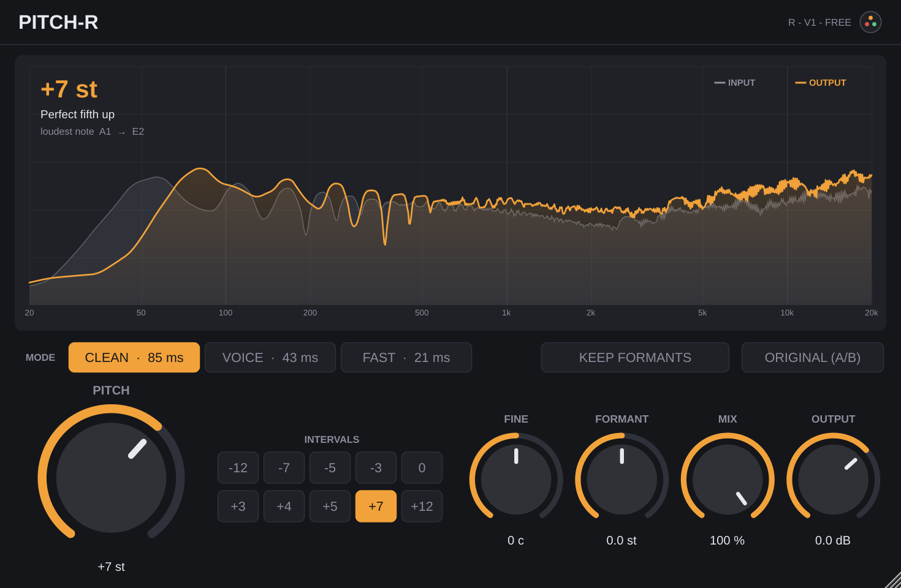

# Pitch-R — Manual

[Español](#español) · [English](#english) · [Primeros pasos / Getting started](primeros-pasos.md) · [Todos los manuales / All manuals](README.md)

---

## Español

### ¿Qué hace?

Pitch-R **sube o baja el tono** de cualquier sonido sin cambiar su velocidad: una voz, un acorde, un bajo, un sample o una mezcla completa. Sirve para poner un sample en la tonalidad de tu canción, doblar una melodía a la octava o hacer voces más graves o más agudas. Está hecho para sonar limpio: sin tonos fantasma entre las notas de un acorde y sin "pre-eco" en los golpes.

La pantalla muestra el espectro de **ENTRADA** y **SALIDA**, el nombre del intervalo (por ejemplo "Quinta justa arriba") y la nota más fuerte antes y después (A2 → E3).

### Empieza en 1 minuto

1. Cárgalo como **efecto** en la pista (ver [Primeros pasos](primeros-pasos.md)).
2. Elige el **MODO**: **LIMPIO** para acordes, mezclas y samples; **VOZ** para una sola voz o instrumento; **RÁPIDO** para tocar o cantar en vivo.
3. Mueve **TONO** o pulsa un botón de **INTERVALOS** (-12, -7, -5, -3, 0, +3, +4, +5, +7, +12).
4. Si es una voz, enciende **CONSERVAR FORMANTES** para que siga sonando a la misma persona.
5. Pulsa **ORIGINAL (A/B)** para comparar con la señal sin cambiar.

### Controles

**MODO E INTERVALOS**

| Control | Rango (inicio) | Qué hace |
| --- | --- | --- |
| **MODO** | Limpio, Voz, Rápido (Limpio) | Limpio: la mejor calidad, más latencia (unos 85 ms). Voz: para una sola voz o instrumento, la mitad de latencia (unos 43 ms). Rápido: la menor latencia (unos 21 ms), los acordes suenan menos limpios. Cada botón muestra su latencia real en ms. |
| **INTERVALOS** | -12 a +12 | Botones rápidos: ponen TONO en ese valor y el AJUSTE FINO en 0. Pasa el mouse encima para ver el nombre del intervalo. |

**TONO**

| Control | Rango (inicio) | Qué hace |
| --- | --- | --- |
| **TONO** | -24 a +24 semitonos (0) | Cuántos semitonos sube o baja. 12 = una octava. |
| **AJUSTE FINO** | -100 a +100 cents (0) | Ajuste fino (100 cents = 1 semitono), para afinar un sample a tu canción. |
| **CONSERVAR FORMANTES** | encendido / apagado (apagado) | La voz cambia de nota pero sigue sonando a la misma persona (sin efecto ardilla ni monstruo). Para voces; en instrumentos y mezclas déjalo apagado. |
| **FORMANTE** | -12 a +12 semitonos (0) | Mueve el timbre sin cambiar la nota: negativo = voz más grande y grave, positivo = más pequeña y aguda. Funciona aunque TONO esté en 0. |

**SALIDA**

| Control | Rango (inicio) | Qué hace |
| --- | --- | --- |
| **MIX** | 0 a 100 % (100 %) | Mezcla con la señal original. 50 % = la original más la copia con otro tono. |
| **SALIDA** | -24 a +12 dB (0 dB) | Ganancia final. |
| **ORIGINAL (A/B)** | encendido / apagado (apagado) | Escuchas la señal sin cambiar, con la misma latencia, para comparar. |

### Recetas

- **Sample en la tonalidad de tu canción:** modo Limpio. Sube o baja TONO hasta que la nota de "después" en la pantalla sea la de tu canción. Termina con AJUSTE FINO si el sample estaba un poco desafinado.
- **Octava doblada:** botón **+12** o **-12** y MIX al 50 %. Queda muy bien en leads y en bajos.
- **Voz más grave sin sonar a monstruo:** modo Voz, TONO -3 a -5 y CONSERVAR FORMANTES encendido.
- **Voz de ardilla o de monstruo (a propósito):** CONSERVAR FORMANTES apagado y TONO en +7/+12 o en -7/-12.
- **Cambiar el timbre sin cambiar la nota:** TONO en 0 y mueve FORMANTE (por ejemplo -3 para una voz más "grande").
- **Cantar o tocar en vivo con el efecto:** modo Rápido, para que el retraso casi no se note.

### Tips

- En 0 st, sin mover el formante, la señal pasa idéntica (solo con el retraso del modo).
- El DAW compensa la latencia solo, así que la pista sigue a tiempo al reproducir. Al grabar en vivo, usa el modo Rápido.
- Para acordes y mezclas completas usa Limpio; Voz y Rápido están pensados para una sola nota a la vez.
- Saltos muy grandes (más de una octava) siempre cambian el carácter del sonido. Prueba MIX por debajo de 100 % para que suene más natural.

---

## English

### What does it do?

Pitch-R **shifts the pitch** of any sound up or down without changing its speed: a vocal, a chord, a bass, a sample or a full mix. Use it to put a sample in your song's key, double a melody at the octave, or make vocals deeper or higher. It is built to sound clean: no ghost tones between the notes of a chord and no "pre-echo" on hits.

The display shows the **INPUT** and **OUTPUT** spectrum, the interval's name (e.g. "Perfect fifth up") and the loudest note before and after (A2 → E3).

### Start in 1 minute

1. Load it as an **effect** on the track (see [Getting started](primeros-pasos.md)).
2. Pick the **MODE**: **CLEAN** for chords, mixes and samples; **VOICE** for one voice or instrument; **FAST** for playing or singing live.
3. Move **PITCH** or press an **INTERVALS** button (-12, -7, -5, -3, 0, +3, +4, +5, +7, +12).
4. If it's a vocal, turn on **KEEP FORMANTS** so it still sounds like the same person.
5. Press **ORIGINAL (A/B)** to compare with the unchanged signal.

### Controls

**MODE & INTERVALS**

| Control | Range (default) | What it does |
| --- | --- | --- |
| **MODE** | Clean, Voice, Fast (Clean) | Clean: best quality, most latency (about 85 ms). Voice: for one voice or instrument, half the latency (about 43 ms). Fast: lowest latency (about 21 ms), chords sound less clean. Each button shows its real latency in ms. |
| **INTERVALS** | -12 to +12 | Quick buttons: set PITCH to that value and FINE to 0. Hover to see the interval's name. |

**PITCH**

| Control | Range (default) | What it does |
| --- | --- | --- |
| **PITCH** | -24 to +24 semitones (0) | How many semitones up or down. 12 = one octave. |
| **FINE** | -100 to +100 cents (0) | Fine tuning (100 cents = 1 semitone), to tune a sample to your song. |
| **KEEP FORMANTS** | on / off (off) | The voice changes note but still sounds like the same person (no chipmunk or monster). For vocals; leave it off on instruments and mixes. |
| **FORMANT** | -12 to +12 semitones (0) | Moves the timbre without changing the note: negative = bigger, deeper voice; positive = smaller, brighter. Works even with PITCH at 0. |

**OUTPUT**

| Control | Range (default) | What it does |
| --- | --- | --- |
| **MIX** | 0 to 100 % (100 %) | Blend with the original signal. 50 % = the original plus the shifted copy. |
| **OUTPUT** | -24 to +12 dB (0 dB) | Final gain. |
| **ORIGINAL (A/B)** | on / off (off) | Hear the unchanged signal, with the same latency, to compare. |

### Recipes

- **Sample in your song's key:** Clean mode. Move PITCH until the "after" note on the display matches your song. Finish with FINE if the sample was slightly out of tune.
- **Octave double:** press **+12** or **-12** and set MIX to 50 %. Great on leads and bass.
- **Deeper vocal without the monster sound:** Voice mode, PITCH -3 to -5 and KEEP FORMANTS on.
- **Chipmunk or monster voice (on purpose):** KEEP FORMANTS off and PITCH at +7/+12 or -7/-12.
- **Change the timbre, not the note:** PITCH at 0 and move FORMANT (e.g. -3 for a "bigger" voice).
- **Singing or playing live through it:** Fast mode, so the delay is barely noticeable.

### Tips

- At 0 st, with the formant untouched, the signal passes through identical (only delayed by the mode's latency).
- Your DAW compensates the latency on its own, so the track stays in time on playback. When recording live, use Fast mode.
- Use Clean for chords and full mixes; Voice and Fast are meant for one note at a time.
- Very large jumps (more than an octave) always change the character of the sound. Try MIX below 100 % so it sounds more natural.
